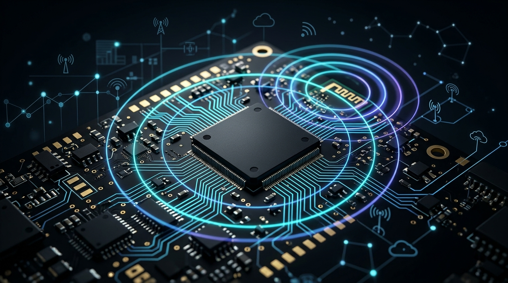

  

# 👋 Hi, I'm Hamza Hachoum

  
  
  
  

  

---

### 👨‍💻 Executive Summary

🎓 **State Engineer in Applied Sciences & Technology** (*Specializing in Embedded Systems & Internet of Things*) from the **Higher Institute of Computer Science and Multimedia of Gabès (ISIMG)**.
- Graduated with **Honors (Mention Bien)**, with a Graduation Project (PFE) awarded **18.00 / 20** (Congratulations of the Jury).
- Specialized in **custom PCB design (up to 4-layer)**, **microcontroller firmware (bare-metal & FreeRTOS)**, **industrial telemetry (CAN, Modbus)**, and **secure Edge-to-Cloud IoT architectures**.

---

### 💡 Core Engineering Competencies

- ⚡ **Hardware & PCB Engineering:** High-density multilayer schematic capture & layout in **KiCad 8/10**, routing power planes, differential pairs, high-speed signals, impedance matching, power delivery (USB-C PD), and EMC/EMI considerations.
- 📟 **Firmware & Embedded Systems:** Low-level driver development, HAL, CMSIS, register-level programming on **STM32 (Cortex-M)** & **ESP32**, deterministic multitasking with **FreeRTOS**, and hardware timers/DMA.
- 📡 **Industrial & Wireless Protocols:** Real-time fieldbus architectures (**CAN Bus 2.0A/B, Modbus RTU/TCP, RS-485**), peripheral buses (**SPI, I2C, UART**), and wireless IoT stacks (**LoRaWAN, MQTT/MQTTS, CoAP, BLE**).
- ☁️ **IoT Systems & Cloud Integration:** End-to-end edge gateways, secure telemetry ingestion, data pipelines, containerized microservices (**Docker**), and dashboard virtualization (**ThingsBoard, AWS IoT Core**).

---

### 🛠️ Technical Arsenal

<table>
  <tr>
    <td width="25%" valign="top"><b>Hardware & Electronics</b></td>
    <td width="75%">
      
      
      
      
      
      
      
    </td>
  </tr>
  <tr>
    <td width="25%" valign="top"><b>Languages & Firmware</b></td>
    <td width="75%">
      
      
      
      
      
    </td>
  </tr>
  <tr>
    <td width="25%" valign="top"><b>Buses & Protocols</b></td>
    <td width="75%">
      
      
      
      
      
      
    </td>
  </tr>
  <tr>
    <td width="25%" valign="top"><b>Cloud & System Tools</b></td>
    <td width="75%">
      
      
      
      
      
      
    </td>
  </tr>
</table>

---

### 🚀 Highlighted Engineering Projects

<table>
  <tr>
    <td width="50%">
      <h3 align="center"><a href="https://github.com/HmzaHch/STM32Project">⚡ 4-Layer STM32G431 CAN & USB-C Board</a></h3>
      
Custom 4-layer high-density PCB designed in <b>KiCad 10</b> around the ARM Cortex-M4 <b>STM32G431</b> microcontroller. Integrates USB-C Power Delivery, CAN transceiver for industrial fieldbus telemetry, low-noise power regulation, and ESD protection.

      

        
        
        
      

    </td>
    <td width="50%">
      <h3 align="center"><a href="https://github.com/HmzaHch/LastSmartBuilding">🏢 Smart Building 3D & Universal Node</a></h3>
      
Complete end-to-end cyber-physical IoT telemetry system featuring environmental sensing, energy metering, edge aggregation nodes, and real-time visualization dashboards for smart infrastructures.

      

        
        
        
      

    </td>
  </tr>
  <tr>
    <td width="50%">
      <h3 align="center"><a href="https://github.com/HmzaHch/PFE">🎓 IoT Edge-to-Cloud Platform (PFE)</a></h3>
      
Graduation project awarded <b>18.00 / 20 (Congratulations of the Jury)</b>. Designed an end-to-end edge-to-cloud connected ecosystem with encrypted data streams, intelligent edge decision-making, and robust cloud storage.

      

        
        
        
      

    </td>
    <td width="50%">
      <h3 align="center">🏭 Predictive Maintenance & Edge AI</h3>
      
Edge anomaly detection system analyzing real-time vibration and temperature patterns on industrial rotating machinery using low-power MCU nodes and digital signal processing (Graded <b>17.20 / 20</b>).

      

        
        
        
      

    </td>
  </tr>
</table>

---

### 📊 Live GitHub Statistics & Activity

  <table border="0">
    <tr>
      <td align="center" width="50%">
        
      </td>
      <td align="center" width="50%">
        
      </td>
    </tr>
    <tr>
      <td align="center" colspan="2">
        
      </td>
    </tr>
  </table>

---

  <h3>🤝 Open to Collaboration & Engineering Challenges</h3>
  
Interested in embedded firmware development, custom PCB engineering, or IoT solutions? Let's talk!

  
  
  
  

